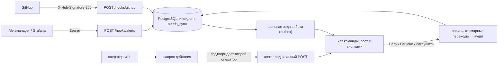

# Telegram ChatOps

Дежурный пульт команды в Telegram. Алерты из Alertmanager/Grafana и события GitHub превращаются в инциденты в чате команды с кнопками «✋ Беру / ✅ Решено / 🔕 Заглушить». Критичное без реакции эскалируется дежурному, а затем всем операторам. Есть расписание дежурств, runbook-действия через подписанного агента с правилом «двух ключей» и журнал аудита. Сам бот ничего не выполняет у себя: у него нет shell, только каталог действий и подписанные запросы к вашему агенту.

[](LICENSE)
[](https://github.com/tgKishikaisei/telegram-chatops/actions/workflows/ci.yml)

## Как устроено



Два процесса: `python -m bot.web` принимает вебхуки и только пишет в БД, `python -m bot` публикует и обновляет посты, эскалирует и отвечает на кнопки. Если Telegram недоступен, алерт не теряется: пост уйдёт в следующий проход фоновой задачи.

## Возможности

| Раздел | Что внутри |
|---|---|
| Алерты | формат Alertmanager/Grafana (`{"alerts": [...]}`) и простой `{"title","severity","text","id"}`; повторы того же алерта — счётчик в посте, а не спам; `resolved` закрывает инцидент сам |
| GitHub | упавшая сборка в основной ветке → инцидент, зелёная → закрыт; упавший деплой → critical; успешный деплой и PR — уведомления |
| Инциденты | пост с важностью, статусом, кто взял и кто решил; кнопки; `/incident` — завести вручную; `/status`, `/incidents` |
| Эскалация | critical без «Беру» N минут → личка дежурному, 2N → всем операторам и сообщение в чат |
| Дежурства | `/oncall_set ID ID…` (смена по понедельникам), `/oncall`, `/take [часы]` — взять смену |
| Действия | только из `bot/content/actions.json`; параметры — по шаблонам; опасные подтверждает другой оператор за N минут |
| Аудит | каждое действие людей и системы; `/audit` — последние 20 записей (админ) |
| Роли | viewer — смотреть, operator — действовать, admin — роли и дежурства; `/whoami` — узнать свой ID |

## Безопасность

| Угроза | Защита |
|---|---|
| Поддельный алерт | Bearer-токен, сравнение за постоянное время — до разбора и обращения к БД |
| Поддельный или повторный вебхук GitHub | HMAC-SHA256 тела (`X-Hub-Signature-256`); `X-GitHub-Delivery` — уникальный ключ, повтор игнорируется |
| Выполнение команд из чата | бот **ничего не выполняет у себя**; только действия из каталога, параметры — по регулярным шаблонам; каталог проверяется при старте (ошибка — бот не запустится) |
| Ошибка или злоупотребление одного человека | опасные действия подтверждает другой оператор и только в течение N минут; запрос старше — истекает |
| Подделка запроса агенту | `X-Signature: sha256=HMAC(secret, "<ts>.<тело>")` и `X-Timestamp`; агент проверяет подпись, возраст ≤ 5 мин и одноразовость `request_id` |
| Посторонние в чате | бот отвечает только участникам команды (кроме `/whoami`); роли проверяются в сервисах; админ не может понизить самого себя |
| Потеря алерта при сбое Telegram | outbox: вебхук только пишет в БД; пост публикует фоновая задача, флаг снимается лишь при неизменной ревизии |
| Инъекция разметки из алертов | строки обрезаются, управляющие символы удаляются, при показе — экранируются |

Подробнее — в [SECURITY.md](SECURITY.md).

## Агент runbook-действий

Агент — небольшой сервис в вашей инфраструктуре, который знает, *как* выполнить `restart_api` и т. п. Проверка входящего запроса:

```python
import hashlib, hmac, json, time

def verify(headers, body: bytes, secret: str, seen_ids: set) -> bool:
    ts = headers.get("X-Timestamp", "")
    if not ts.isdigit() or abs(time.time() - int(ts)) > 300:
        return False
    expected = "sha256=" + hmac.new(secret.encode(), ts.encode() + b"." + body, hashlib.sha256).hexdigest()
    if not hmac.compare_digest(headers.get("X-Signature", ""), expected):
        return False
    request_id = json.loads(body)["request_id"]
    if request_id in seen_ids:      # одноразовость
        return False
    seen_ids.add(request_id)
    return True
```

Ответ агента: `{"ok": true, "output": "…"}` (до 3500 символов покажется в чате).

## Структура

```
telegram-chatops/
├── bot/
│   ├── models/ops.py             ← members, incidents (revision для outbox), webhook_deliveries, notices,
│   │                               oncall, oncall_overrides, action_requests, audit_log
│   ├── services/webhooks.py      ← подлинность (Bearer, HMAC GitHub) и разбор в единые события
│   ├── services/incidents.py     ← приём с дедупликацией, роли, переходы, эскалация, дежурства
│   ├── services/runbooks.py      ← каталог действий, параметры по шаблонам, правило двух ключей
│   ├── gateways/agent.py         ← подписанные запросы агенту · gateways/team.py — посты инцидентов
│   ├── web/app.py                ← POST /hooks/alerts, POST /hooks/github
│   ├── handlers/ops.py · jobs/ops.py
│   ├── content/actions.json      ← каталог действий (меняется только через код-ревью и сборку образа)
│   └── core/                     ← общая инфраструктура: настройки, БД, Redis, лимиты, логи, веб-защита
├── migrations/                   ← Alembic
├── deploy/                       ← Caddy (HTTPS), роли PostgreSQL, Redis
├── tests/                        ← 41 тест
└── docker-compose.yml            ← PostgreSQL, Redis, migrate, bot, web, caddy
```

## Стек

Python 3.12, aiogram 3, FastAPI, SQLAlchemy 2 (async), Alembic, PostgreSQL, Redis, Docker Compose, Caddy.

## Запуск

```bash
git clone https://github.com/tgKishikaisei/telegram-chatops.git
cd telegram-chatops
python -m venv .venv
.venv\Scripts\activate              # Linux и macOS: source .venv/bin/activate
pip install -r requirements.txt
cp .env.example .env                # BOT_TOKEN, TEAM_CHAT_ID, PUBLIC_URL, три секрета, ADMIN_IDS
python -m bot                       # бот
python -m bot.web                   # приём вебхуков на :8000
```

Alertmanager: `webhook_configs: url: https://<домен>/hooks/alerts`, `http_config.authorization.credentials: <ALERT_WEBHOOK_SECRET>`. GitHub: Settings → Webhooks → `https://<домен>/hooks/github`, Content type `application/json`, Secret — `GITHUB_WEBHOOK_SECRET`, события Workflow runs, Deployment statuses, Pull requests.

**Продакшен.** Положите секреты файлами в `secrets/` (как — в [secrets/README.md](secrets/README.md)), укажите `DOMAIN` и `ACME_EMAIL` в `.env` и запустите `docker compose up -d --build`. Caddy сам получит сертификат, схему базы создаст `alembic upgrade head` в сервисе `migrate`.

## Тесты

```bash
pip install -r requirements-dev.txt
python -m pytest -q
```

Покрыты: Bearer и подпись GitHub; разбор Alertmanager (firing/resolved), простого формата и мусора; разбор GitHub (сборка в основной и другой ветке, деплой, PR); дедупликация и авторазрешение; роли и переходы (viewer не может, повторное «Беру», заглушка и её окончание, ручной инцидент), аудит; эскалация по уровням ровно один раз; дежурства (кто не оператор, смена по неделям, взятие смены); управление ролями; каталог и параметры (запрещённые имена, «;rm», лишние и недостающие); **правило двух ключей** (сам себе, наблюдатель, второй оператор, повтор, истечение); подпись запроса агенту; HTTP-приёмник целиком (401, outbox, 400, подпись, повтор доставки, ping).

Сборка Docker-образа проверяется в CI. Вживую с Telegram, Alertmanager и GitHub проект не обкатывался.
